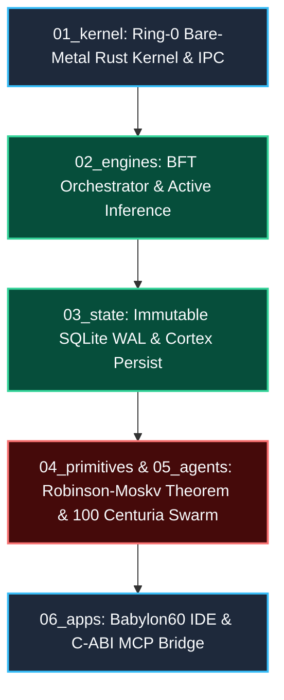

<!-- C5-REAL EXERGY CERTIFIED -->

# TEOREMA-ROBINSON-MOSKV (C5-REAL ABSOLUTE CORE)

> **MOSKV-1 BFT Cortex — Byzantine Fault-Tolerant Cognitive Architecture, Lean 4 Formal Proofs & 15 Logical Constellations.**

[](https://github.com/borjamoskv/teorema-robinson-moskv/actions)
[](./LICENSE)

---

## ⚡ Quickstart & Installation

> [!CAUTION]
> **⚠️ ADVERTENCIA DE SEGURIDAD**: El único paquete oficial es `cortex-persist`. Verifique siempre la huella digital (SHA-256) en nuestra documentación oficial. No instale variantes como `cortex_persist` o `babylon60-kernel` que podrían ser intentos de typosquatting y contener código malicioso.

```bash
# 1. Entorno CORTEX Engine (en la raíz del monorrepo)
uv sync

# 2. Compilar C-Extension de seguridad (Ring-0 Guard)
make build-guard

# 3. Verificación de Rust Kernel y Suite CORTEX
cargo check --workspace && pytest && ruff check
```

---

## 🧬 Architecture & Invariants



El repositorio ha sido defragmentado y purgado de toda Anergía estructural. Opera exclusivamente como la base termodinámica de tres ejes fundamentales:

- **Cortex Engine (Python 3.12):** Motor central, orquestador BFT y kernel Quad-Pillar (`cortex`).
- **Cortex Persist:** Base de memoria inmutable y ledger determinista.
- **Babylon 60 IDE (React/TypeScript/Vite):** Frontend de Ejecución C5-REAL (Anti-Green Theater).

### Prerequisites

- Python >= 3.12
- Node.js >= 20
- Rust >= 1.80

### Runtime Verification Commands

```bash
# Iniciar IDE Babylon60
cd src/06_apps/babylon60_ide && npm install && npm run dev

# Verificación de Rust Kernel
cargo check --workspace

# Tests CORTEX (requiere make build-guard previo)
pytest

# Linter CORTEX
ruff check
```

---

## 📂 Structure (6 Physical Strata)

| Stratum        | Path                                                        | Function                              |
| :------------- | :---------------------------------------------------------- | :------------------------------------ |
| 01 Kernel      | `src/01_kernel/`                                            | Ring-0 Bare-Metal Rust Kernel & IPC    |
| 02 Engines     | `src/02_engines/`                                           | BFT Orchestration & Cognitive Engines |
| 03 State       | `src/03_state/`                                             | Physical Ledger & Persistence Memory  |
| 04 Primitives  | `src/04_primitives/`                                        | Categorical Logic & Active Inference  |
| 05 Swarm       | `src/05_agents/`                                            | Multi-Agent Swarm Framework           |
| 06 Apps        | `src/06_apps/babylon60_ide/`                                | Babylon60 IDE (Vite/TS/React)         |
| 06 Apps        | `src/06_apps/mcp_c5_abi_bridge/`                            | Bare-Metal C-ABI MCP Server & Landauer Purge |

---

## 🌌 Monorepo Cartography · High-Exergy Core

> **MOSKV-1 BFT Cortex Systemic Topology**
> *638 Tracked Git Files (Defragmented & Purged) · 15+ execution runtimes · 6 Physical Strata · 15 Logical Constellations.*

```text
   638              6                15             15+              500
Git Files  │ Physical Strata │ Constellations │ Runtimes & Langs │ BFT Cycles
```

> [!NOTE]
> **Separación Topológica (Mapa vs. Territorio):**  
> El árbol físico de ejecución se organiza estrictamente en los **6 estratos de `src/`** (`01_kernel` a `06_apps`). La siguiente matriz de las **15 Constelaciones (Index 001–300)** define la taxonomía lógica e inferencial del sistema formal Babylon-60.

### ■ The 15 Constellations (Index 001–300)

| Constellation | Index Range | Domain & Core Components | Primary Syntaxes / Technologies |
| :--- | :---: | :--- | :--- |
| **I. Languages & Runtimes** | `001–020` | Multi-language execution tree & tree-sitter grammars | Python 3.12, Rust, TS, Go, F#, Lean 4, FunC, Move, CESL |
| **II. Cortex Engines** | `021–040` | Cognitive BFT engines, Active Inference & Virtual Machines | Active Inference, BFT Orchestrator, MCTS, CAM/AEM VM |
| **III. SQLite Ledgers** | `041–060` | Fraud proofs, immutable memory DBs & entropy logs | SQLite WAL, Agent Memory (24MB), State Persistence |
| **IV. Bounty Targets** | `061–080` | Adversarial protocol audits & smart contract security | Base L2, Chainlink, Firedancer, LayerZero, Lido, Solana |
| **V. Axioms & Invariants** | `081–100` | Epistemic foundation & thermodynamic invariants | Chinese Room, Kantian Core, Slop Horizon, Ultrathink 9 |
| **VI. Agents & Briefings** | `101–120` | Swarm orchestration & tactical operational briefs | 100 Centuria Agents, BFT Sentinels, Delta Encoders |
| **VII. Exotic Formats** | `121–140` | Domain-specific formal proofs & hardware policies | `.ots`, `.seccomp`, `.bytecode`, `.spec`, `.move`, `.cesl`, `.lean` |
| **VIII. MOSKV Studio Forges**| `141–160` | Desktop apps, custom IDE & video/audio synthesis | Babylon-60 IDE, Tauri, Exa/Harmony Forges, Remotion |
| **IX. Sequenced Scripts** | `161–180` | Pipeline execution order, guards & theorem provers | HAL Guard, L5 Anchor, BFT Adversarial, Omega Prover |
| **X. Exergy & Anergia** | `181–200` | Thermodynamic LLM capture & deterministic purges | Exergy Capture, Octal Purge, Merkle Delta, FISR Baseline |
| **XI. Substack OSINT Suite** | `201–220` | Intelligence mining, Neo4j graphs & theoretical essays | Substack Miner, Neo4j Graph, 200 Analysis Dossiers |
| **XII. CI / Deployment** | `221–240` | Cloud infra, zero-trust verification & PyO3 compilation | Terraform GCP, CodeQL, Secret Audit, Maturin, Vite 8 |
| **XIII. Primitives 896** | `241–260` | Categorical logic primitives & quantum bridges | Go / Haskell 896, Ephesus Reverse, BQP Quantum |
| **XIV. Lab & Compiler** | `261–280` | Native compiler toolchain, APEX kernel & PyO3 extensions | Moskv84 Compiler, Strike-RS, APEX Kernel, Autopoiesis |
| **XV. Cryptographic Anchors**| `281–300` | Causal proof of work, Bitcoin timestamps & Lean provers | OpenTimestamps L5 (BTC), C7 Attestation, Robinson Lean |

```text
Teorema-Robinson-Moskv · master branch · BFT Cycle 500 · C5-REAL EXERGY CERTIFIED
```

---

## 🛡️ License & Security

MIT License - Copyright (c) 2026 Borja Fernández Angulo (`@borjamoskv`). See [`LICENSE`](./LICENSE) and `SECURITY.md` / `CONTRIBUTING.md` for security vulnerability disclosures and formal verification policies.
